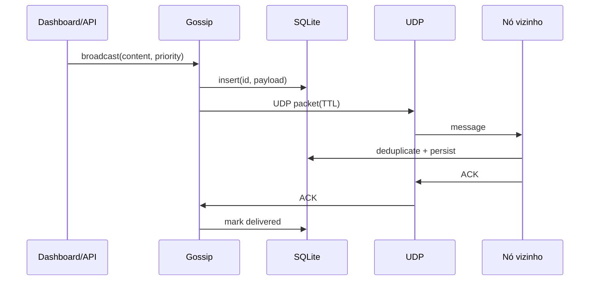
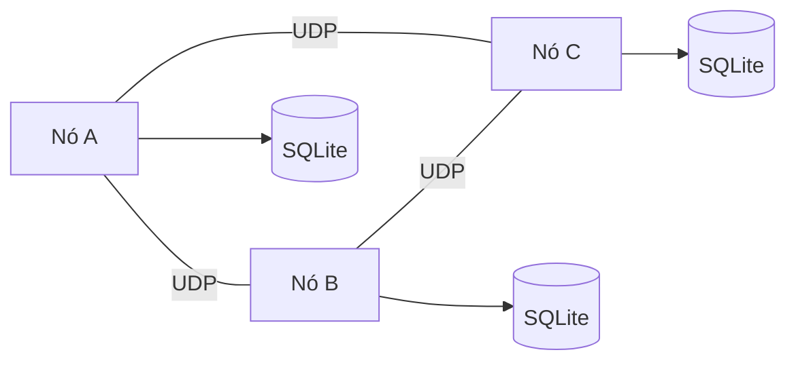

# Arquitetura RescueMesh v2

## Processos OTP

`Repo` persiste mensagens. `NodeId` mantém o identificador local. `Mesh.UDP` possui os sockets. `Discovery` mantém a tabela de vizinhos. `Gossip` aplica TTL e deduplicação. `NeighborMonitor` envia heartbeats. `Messaging.Store` serializa operações de persistência. `Endpoint` expõe Phoenix e LiveView.

## Fluxo de mensagem

## Topologia

## Decisões

A descoberta usa broadcast UDP local; mensagens usam gossip limitado por TTL; a deduplicação usa IDs persistidos no SQLite; o dashboard lê o estado real dos processos, sem dados fictícios.
