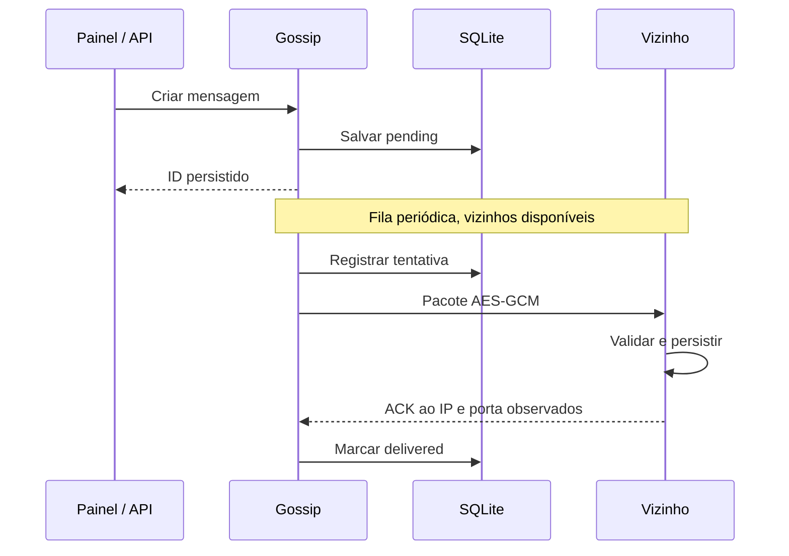

# Arquitetura · RescueMash v3

## Supervisão

A árvore OTP inicializa Repo, PubSub, NodeId, RateLimiter, Discovery, Gossip, UDP, Queue e Endpoint. Cada processo é supervisionado. Store concentra operações Ecto; o Gossip serializa recebimento, ACKs e envio da fila. O modo de testes desativa sockets e timers automáticos, e os testes UDP abrem portas efêmeras reais.

## Entrega

## Modelo de dados

`messages` mantém ID único, origem, conteúdo, TTL, prioridade, status, recibos JSON, instante de criação, tentativas e último envio. A migration v3 é incremental. Deduplicação usa a restrição única no SQLite, sem depender de um conjunto ilimitado na memória. Registros recebidos são diferenciados dos envios locais.

SQLite usa WAL, timeout de escrita e persistência em `DATA_DIR`. A fila lê até 100 pendências por ciclo, por prioridade explícita e idade. Sem vizinhos, não consome tentativas. Após três rodadas sem ACK, registra falha; a repetição manual reinicia o contador. O histórico da interface mostra os últimos 50 registros; a API aceita até 100 por consulta.

## Protocolo v3

Datagrama: `version (1 byte) | nonce (12 bytes) | tag (16 bytes) | ciphertext`. AES-256-GCM usa uma chave de grupo de 32 bytes e AAD `RescueMash/v3`. O JSON cifrado contém `sent_at` e `payload`. O relógio é validado com tolerância de 120 segundos. Datagrama máximo: 16 KiB.

O transporte aceita um pacote por ativação do socket (`active: :once`). Um cache de até 20.000 nonces, retidos por 240 segundos, bloqueia replay recente. Ao atingir o limite, recusa novos pacotes até expiração. Esse cache é volátil; a deduplicação de mensagens continua no banco após reinício.

Discovery transmite `hello` e mantém no máximo 256 vizinhos. Usa relógio monotônico para expiração e a origem UDP observada para endereçamento. O ACK só altera mensagens enviadas e deve corresponder a ID, IP e porta de um vizinho conhecido. Receber o ACK de um membro é suficiente para o estado `delivered`.

## Interface

O pipeline browser configura sessão cifrada/assinada, CSRF, CSP e root layout. Login valida o token pelo hash e renova a sessão. LiveView exige sessão autorizada também na conexão. PubSub atualiza o painel e um timer renova a lista de vizinhos. CSS e JavaScript são locais; não há dependência de CDN.

## Limites

O protocolo pressupõe membros confiáveis que compartilham a chave. Não há identidade criptográfica individual, revogação por nó ou forward secrecy. Não há busca de histórico remoto, sincronização global, ACK de cada destino nem confirmação humana. Relays encaminham uma vez por mensagem nova; confiabilidade entre múltiplos saltos e condições adversas precisa de validação adicional. O SQLite não possui política automática de retenção.
